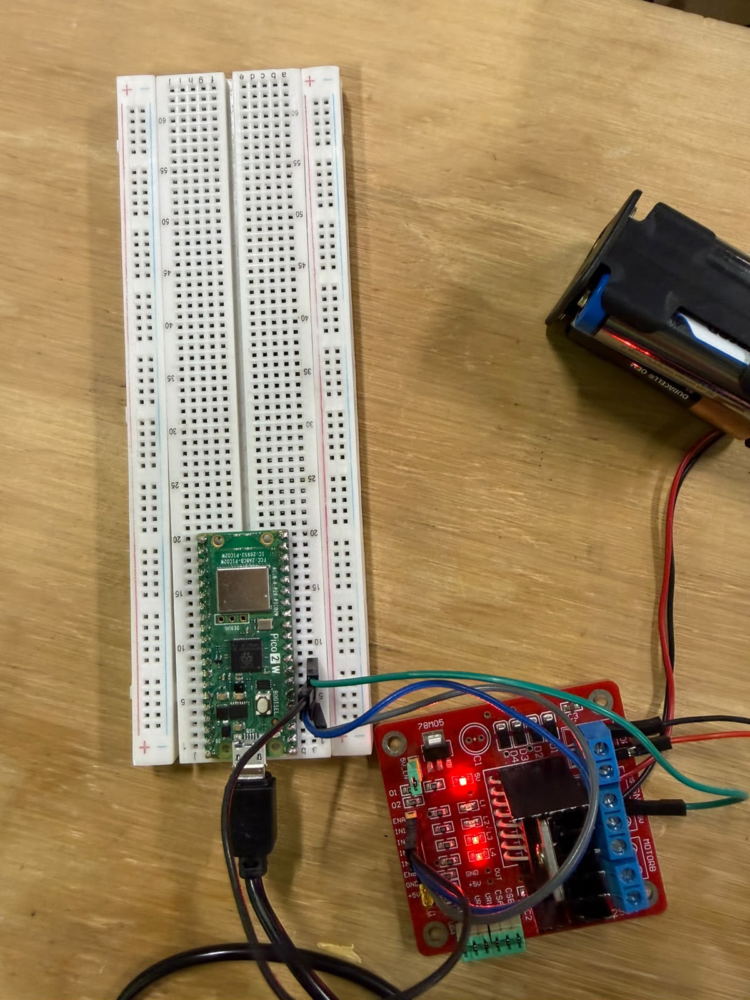

# PWM en RP2040 y RP2350: control de un motor DC desde el REPL

**Actividad integradora por equipos · Elementos Programables · Equipo 2 · Periférico: PWM**

Integrantes:
- Angel Rugerio Jiménez · 201720
- Axel García Arellano · 201251

---

## 1. Objetivo

Configurar y demostrar el **periférico PWM** de la Raspberry Pi Pico (**RP2040**) y de la Raspberry Pi Pico 2 W (**RP2350**) para controlar la **velocidad y el sentido de giro de un motor DC** mediante un puente H **L298N**, usando:

1. **Acceso directo a registros con punteros** (`firmware/src/pwm_regs.c`).
2. La **configuración equivalente con el Pico SDK** (`firmware/src/pwm_sdk.c`).
3. Un **comando propio integrado al REPL del curso**: `motor 50 derecha`.

Además se comparan técnicamente las dos plataformas: registros, direcciones, campos y código.

```
comando REPL → C (argc/argv) → backend (punteros o SDK) → registros PWM/SIO → L298N → motor DC
```

## 2. Estructura del repositorio

```
Proyecto_PWM_Equipo2/
├── README.md                     ← este archivo
├── build.sh                      ← compila para las dos tarjetas
├── uf2/                          ← binarios listos para cargar
│   ├── Motor_PWM_RP2040.uf2
│   └── Motor_PWM_RP2350.uf2
├── firmware/
│   ├── CMakeLists.txt
│   ├── pico_sdk_import.cmake
│   └── src/
│       ├── main.c                ← REPL del curso + comandos motor / pwm / demo
│       ├── motor.c / motor.h     ← rampas, zona muerta, cambio de sentido seguro
│       ├── pwm_backend.h         ← interfaz común de las dos implementaciones
│       ├── pwm_regs.c            ← implementación con PUNTEROS
│       ├── pwm_sdk.c             ← implementación con PICO SDK
│       ├── plataforma.h          ← mapa de registros RP2040 / RP2350 escrito a mano
│       └── verifica_mapa.c       ← comprueba el mapa contra el SDK al compilar
├── docs/
│   ├── 01_investigacion.md       ← qué es, historia, evolución, aplicaciones
│   ├── 02_arquitectura.md        ← slices, reloj, GPIO, IRQ/DMA, L298N
│   ├── 03_mapa_registros.md      ← direcciones, offsets, acceso, bits, valores
│   ├── 04_registros_vs_sdk.md    ← punteros, volatile, máscaras; qué abstrae el SDK
│   ├── 05_comparacion_RP2040_RP2350.md
│   ├── 06_comando_repl.md
│   └── 07_guion_y_preguntas.md   ← guion de 40+ min y banco de preguntas
├── diagramas/                    ← conexiones, arquitectura del slice, flujo del comando
├── presentacion/                 ← diapositivas (PDF)
├── evidencias/                   ← fotos, videos y capturas
└── wokwi/                        ← antecedente: Sesión 06 en MicroPython
```

## 3. Descripción del hardware

El **L298N** contiene dos puentes H. Usamos el puente A:

- **IN1 / IN2** (GP2 / GP3) eligen el **sentido** de la corriente → sentido de giro.
- **ENA** (GP4) recibe el **PWM**: el duty cycle fija qué fracción del tiempo conduce el puente → velocidad.

| IN1 | IN2 | Resultado |
|---|---|---|
| 1 | 0 | derecha (FORWARD) |
| 0 | 1 | izquierda (REVERSE) |
| 0 | 0 | detenido |
| 1 | 1 | freno (no se usa) |

GP4 pertenece al **slice 2, canal A** del PWM (`slice = (4 >> 1) & 7 = 2`; GPIO par → A). La configuración es de **100 Hz**, `TOP = 9999` (10 000 pasos de resolución).

## 4. Lista de componentes

| Cant. | Componente | Nota |
|---|---|---|
| 1 | Raspberry Pi Pico (RP2040) | |
| 1 | Raspberry Pi Pico 2 W (RP2350) | |
| 1 | Módulo puente H L298N | quitar jumper de **ENA** |
| 1 | Motor DC pequeño (3–6 V) | |
| 1 | Fuente externa 5 V (módulo HW-131 o batería) | el motor **no** se alimenta desde la Pico |
| 1 | Protoboard + jumpers macho-hembra | |
| 1 | Cable micro-USB | programación y consola |

## 5. Conexiones


| Pico / Pico 2 W | Pin físico | L298N | Función |
|---|---|---|---|
| GP2 | 4 | IN1 | dirección (SIO) |
| GP3 | 5 | IN2 | dirección (SIO) |
| GP4 | 6 | ENA | velocidad (PWM slice 2 A) |
| GND | 8 | GND | tierra común |
| — | — | OUT1 / OUT2 | terminales del motor |
| Fuente 5 V (+) | — | VS (12V) y +5V | potencia del motor y lógica del L298N |
| Fuente 5 V (−) | — | GND | unida al GND de la Pico |

Notas importantes (aprendidas en la Sesión 06):

- **Quitar el jumper de ENA**: si está puesto, ENA queda fijo a 5 V y el motor siempre va al 100 %.
- Con solo 5 V en VS el regulador interno del L298N no alcanza: se quita el jumper del regulador y se alimenta también **+5V** desde la fuente.
- **GND común** obligatorio entre Pico, L298N y fuente.
- El pinout físico de la Pico y la Pico 2 W es el mismo → **el cableado no cambia** entre tarjetas.

## 6. Software y herramientas

| Herramienta | Versión usada |
|---|---|
| Raspberry Pi Pico SDK | 2.3.1 |
| Toolchain ARM GCC | 15.2.Rel1 (`arm-none-eabi-gcc`) |
| CMake / Ninja | 4.3.4 / 1.13.2 |
| picotool | 2.3.1 |
| VS Code + extensión *Raspberry Pi Pico* | opcional (instala todo lo anterior en `~/.pico-sdk`) |
| Terminal serie | PuTTY, Tera Term, `screen`, `minicom` o el monitor serie de VS Code |

## 7. Compilación

### Opción A: script (Linux / macOS / WSL)

```bash
./build.sh
```

Compila **dos veces el mismo código** con `PICO_BOARD=pico` y `PICO_BOARD=pico2_w` y copia los binarios a `uf2/`:

```
uf2/Motor_PWM_RP2040.uf2
uf2/Motor_PWM_RP2350.uf2
```

### Opción B: manual

```bash
export PICO_SDK_PATH=~/.pico-sdk/sdk/2.3.1
cmake -S firmware -B build_pico    -G Ninja -DPICO_BOARD=pico      # RP2040
cmake --build build_pico
cmake -S firmware -B build_pico2_w -G Ninja -DPICO_BOARD=pico2_w   # RP2350
cmake --build build_pico2_w
```

### Opción C: VS Code

Abrir la carpeta `firmware/` con la extensión Raspberry Pi Pico, elegir la tarjeta (`pico` o `pico2_w`) y pulsar **Compile**.

El proyecto compila **sin warnings** con `-Wall -Wextra`. Si alguna dirección de `plataforma.h` no coincidiera con la documentación oficial del chip, `verifica_mapa.c` detendría la compilación.

## 8. Carga del programa

1. Desconectar la tarjeta, mantener presionado **BOOTSEL** y conectar el USB.
2. Aparece una unidad `RPI-RP2` (Pico) o `RP2350` (Pico 2 W).
3. Copiar el `.uf2` **correspondiente**:
   - Pico → `Motor_PWM_RP2040.uf2`
   - Pico 2 W → `Motor_PWM_RP2350.uf2`
4. La tarjeta se reinicia sola.

Alternativa: `picotool load -x uf2/Motor_PWM_RP2350.uf2 -f`.

## 9. Uso del REPL

Abrir el puerto serie USB de la Pico (115200 baudios; con USB-CDC la velocidad no importa), por ejemplo `screen /dev/ttyACM0 115200`. Presionar Enter y escribir `help`.

| Comando | Qué hace |
|---|---|
| `motor <0-100> <derecha\|izquierda>` | Mueve el motor con rampa; si cambia el sentido baja primero a 0 % |
| `motor stop` | Rampa a 0 % y detiene |
| `motor estado` | Dirección, %, `CC.A`, duty real, frecuencia, backend |
| `pwm regs` | Lee y decodifica los registros del slice con punteros |
| `pwm info` | Direcciones base y diferencias del chip actual |
| `pwm modo <regs\|sdk>` | Elige la implementación: punteros o Pico SDK |
| `pwm freq <hz>` | Cambia la frecuencia (recalcula `DIV`) |
| `pwm top <n>` | Cambia la resolución (`TOP`) |
| `pwm fase <on\|off>` | Modo phase-correct |
| `pwm inv <on\|off>` | Invierte la salida |
| `demo` | Secuencia CHALLENGE 06 |
| `help`, `on`, `off`, `toggle`, `read`, `sio`, `mask`, `status` | Comandos originales del REPL del curso |

Ejemplo:

```text
RP2350> motor 50 derecha
argv[1] = "50" -> 50 %   argv[2] = "derecha" -> DERECHA (FORWARD)
[DIRECCION] DERECHA (FORWARD)  IN1=1 IN2=0
Acelerando: 0 5 10 15 20 25 30 35 40 45 50 %  (CC.A = 7000 de TOP+1 = 10000)
Motor     : DERECHA (FORWARD) a 50 % logico
ENA GPIO4 : CC.A = 7000 / TOP+1 = 10000  -> duty real 70 %
PWM       : 100 Hz, backend regs (punteros)
```

Detalle completo, validación de argumentos y sesión de ejemplo: [`docs/06_comando_repl.md`](docs/06_comando_repl.md).

## 10. Implementación mediante registros

Archivo: [`firmware/src/pwm_regs.c`](firmware/src/pwm_regs.c). Mapa: [`docs/03_mapa_registros.md`](docs/03_mapa_registros.md).

Secuencia **dirección base → offset → dirección → puntero → valor → periférico**:

```c
#define PWM_BASE_ADDR   0x40050000u   /* RP2040 · 0x400A8000u en RP2350 */
/* slice 2 → offset 0x14 * 2 = 0x28 ; CC → +0x0C ; dirección = 0x40050034 */
static volatile uint32_t *const pwm_cc =
    (volatile uint32_t *)PWM_SLICE_REG(PWM_SLICE_ENA, PWM_CC_OFS);

*pwm_cc = (*pwm_cc & 0xFFFF0000u) | 7000;   /* CC.A = 7000 → 70 % */
```

Pasos de inicialización hechos a mano:

1. **RESETS**: quitar el reset del PWM (alias CLR `+0x3000`) y esperar `RESET_DONE`.
2. **PADS_BANK0**: `OD = 0`, `IE = 1` y, en RP2350, `ISO = 0`.
3. **IO_BANK0**: `GPIO4_CTRL.FUNCSEL = 4` (PWM); `GPIO2/3_CTRL.FUNCSEL = 5` (SIO).
4. **SIO**: `GPIO_OE_SET` para IN1/IN2 como salidas.
5. **PWM**: `CSR = 0` → `DIV = (INT << 4) | FRAC` → `TOP = 9999` → `CTR = 0` → `CSR = EN`.
6. **Velocidad**: escribir `CC.A`.

`volatile`, máscaras y campos de bits explicados en [`docs/04_registros_vs_sdk.md`](docs/04_registros_vs_sdk.md).

## 11. Implementación mediante SDK

Archivo: [`firmware/src/pwm_sdk.c`](firmware/src/pwm_sdk.c).

```c
gpio_set_function(PIN_ENA, GPIO_FUNC_PWM);
pwm_config pc = pwm_get_default_config();
pwm_config_set_clkdiv_int_frac4(&pc, div_int, div_frac);
pwm_config_set_wrap(&pc, 9999);
pwm_init(pwm_gpio_to_slice_num(PIN_ENA), &pc, true);
pwm_set_gpio_level(PIN_ENA, 7000);
```

Con `pwm modo sdk` el REPL usa esta implementación. `pwm regs` (que siempre lee con punteros) muestra que **el SDK escribe exactamente los mismos valores** en los mismos registros. La tabla función ↔ registro, ventajas y limitaciones está en [`docs/04_registros_vs_sdk.md`](docs/04_registros_vs_sdk.md#43-qué-abstrae-el-sdk-relación-función--registro).

## 12. Diferencias RP2040 / RP2350

| | RP2040 | RP2350 |
|---|---|---|
| `PWM_BASE` | `0x40050000` | `0x400A8000` |
| Slices | 8 | 12 |
| `EN` / `INTR` | `+0xA0` / `+0xA4` | `+0xF0` / `+0xF4` |
| Líneas de IRQ del PWM | 1 (`INTE/INTF/INTS`) | 2 (`IRQ0_*`, `IRQ1_*`) |
| Bit PWM en `RESETS` | 14 | 16 |
| `IO_BANK0` / `PADS_BANK0` | `0x40014000` / `0x4001C000` | `0x40028000` / `0x40038000` |
| Bit `ISO` en pads | no | sí (hay que limpiarlo) |
| SIO `OUT_SET`/`OUT_CLR`/`OE_SET` | `+0x14`/`+0x18`/`+0x24` | `+0x18`/`+0x20`/`+0x38` |
| `clk_sys` | 125 MHz | 150 MHz |
| `DIV` para 100 Hz (TOP 9999) | 125.0 (`0x7D0`) | 150.0 (`0x960`) |
| Registros por slice y sus bits | iguales | iguales |

En el código, todas las diferencias están en [`plataforma.h`](firmware/src/plataforma.h) con `#if PICO_RP2040 / #elif PICO_RP2350`. La versión SDK es idéntica en ambas. Análisis completo: [`docs/05_comparacion_RP2040_RP2350.md`](docs/05_comparacion_RP2040_RP2350.md).

## 13. Procedimiento para reproducir la demostración

1. Armar el circuito de la sección 5 (jumper ENA fuera, GND común).
2. Compilar (`./build.sh`) o usar los `.uf2` de `uf2/`.
3. Cargar el `.uf2` de la tarjeta y abrir la terminal serie.
4. Ejecutar:

```text
help
pwm info
motor 50 derecha          → el motor gira a la derecha
pwm regs                  → ver DIV, TOP, CC.A = 7000, f = 100 Hz
motor 100 derecha         → acelera
motor 30 izquierda        → baja a 0, invierte, acelera
motor 150 derecha         → error de validación
pwm modo sdk
motor 50 derecha
pwm regs                  → mismos valores con el SDK
demo                      → secuencia completa
motor stop
```

5. Repetir con la otra tarjeta y comparar `pwm info` / `pwm regs`.

Guion detallado: [`docs/07_guion_y_preguntas.md`](docs/07_guion_y_preguntas.md).

### Problemas comunes

| Síntoma | Causa probable |
|---|---|
| El motor siempre va al 100 % | Jumper de ENA puesto |
| El motor solo zumba | Fuente débil o duty muy bajo; revisar GND común |
| La Pico se reinicia al arrancar el motor | Fuente del motor sin corriente suficiente (HW-131 ≈ 700 mA) |
| No aparece la consola | Abrir el puerto después de que la tarjeta arranque y presionar Enter |
| En la Pico 2 W el pin no cambia (código propio) | Faltó limpiar `PADS.ISO` |

## 14. Evidencias

Ver [`evidencias/`](evidencias/README.md): montaje, video, capturas del REPL y de `pwm regs` en ambas tarjetas.



## 15. Presentación

Diapositivas en [`presentacion/`](presentacion/). Duración planeada ≥ 40 min (guion en `docs/07_guion_y_preguntas.md`).

## 16. Referencias

1. Raspberry Pi Ltd. *RP2040 Datasheet*, cap. 2.14 (Resets), 2.19 (GPIO), 4.5 (PWM). https://datasheets.raspberrypi.com/rp2040/rp2040-datasheet.pdf
2. Raspberry Pi Ltd. *RP2350 Datasheet*, cap. 7.5 (Resets), 9 (GPIO), 12.5 (PWM). https://datasheets.raspberrypi.com/rp2350/rp2350-datasheet.pdf
3. Raspberry Pi Ltd. *Raspberry Pi Pico-series C/C++ SDK*. https://datasheets.raspberrypi.com/pico/raspberry-pi-pico-c-sdk.pdf
4. Raspberry Pi Pico SDK – `hardware_pwm` API. https://www.raspberrypi.com/documentation/pico-sdk/hardware.html#group_hardware_pwm
5. Raspberry Pi Ltd. *Raspberry Pi Pico Datasheet* y *Pico 2 W Datasheet* (pinout). https://datasheets.raspberrypi.com/
6. STMicroelectronics. *L298 Dual Full-Bridge Driver Datasheet*. https://www.st.com/resource/en/datasheet/l298.pdf
7. Mohan, N., Undeland, T., Robbins, W. *Power Electronics: Converters, Applications, and Design*. Wiley.
8. Rashid, M. H. *Electrónica de potencia*. Pearson.
9. Barr, M. "Introduction to Pulse Width Modulation (PWM)". *Embedded Systems Programming*, 2001.
10. Material de la Sesión 06 del laboratorio: PWM + Puente H L298N + Motor DC.
