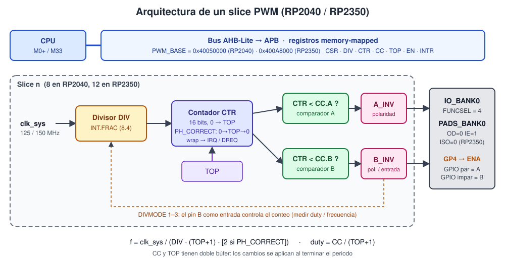
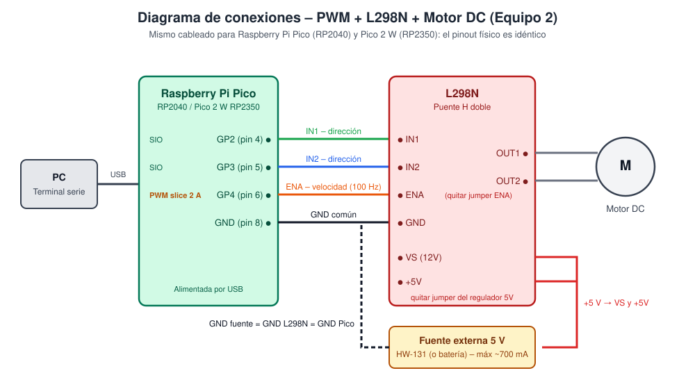

# 2. Arquitectura del periférico PWM (RP2040 / RP2350)



## 2.1 Bloques internos

El PWM está dividido en **slices** (rebanadas). Cada slice es un generador independiente con **dos salidas (canal A y canal B)** que comparten frecuencia pero pueden tener duty distinto.

| | RP2040 | RP2350 |
|---|---|---|
| Slices | 8 (0–7) | 12 (0–11) |
| Salidas | 16 | 24 |
| Slices 8–11 | — | Solo con pines en el **RP2350B** (QFN-80, GPIO 32–47). La Pico 2 W usa **RP2350A** (30 GPIO), así que en la práctica usa 0–7 igual que la Pico |

Dentro de cada slice:

1. **Divisor de reloj fraccional (`DIV`)** – 8 bits enteros + 4 fraccionarios (1.0 a 255.9375). Reduce `clk_sys` antes de llegar al contador.
2. **Contador de 16 bits (`CTR`)** – cuenta de 0 a `TOP` y vuelve a 0 (*wrap*). En modo **phase-correct** cuenta 0 → TOP → 0 (triángulo), lo que duplica el periodo y centra los pulsos.
3. **Registro `TOP`** – valor máximo del contador. Define el periodo y la resolución del duty.
4. **Dos comparadores (`CC.A`, `CC.B`)** – la salida está en alto mientras `CTR < CC`. Por eso:
   - `CC = 0` → siempre bajo (0 %)
   - `CC = TOP + 1` → siempre alto (100 %)
5. **Lógica de polaridad (`A_INV`, `B_INV`)** – invierte cada salida.
6. **Control del divisor (`DIVMODE`)** – el contador puede avanzar libre, o usar el **pin B como entrada**: avanzar solo mientras B está en alto (medir duty) o en cada flanco de B (medir frecuencia / contar pulsos).
7. **Avance / retraso de fase (`PH_ADV`, `PH_RET`)** – adelanta o atrasa el contador un ciclo, para desfasar slices entre sí.
8. **Doble búfer** – `CC` y `TOP` escritos por el CPU se copian al hardware **al terminar el periodo** (en el wrap), así cambiar la velocidad nunca genera un pulso a medias.

## 2.2 Fórmulas

```
Modo normal (diente de sierra):   f_PWM = clk_sys / ( DIV × (TOP + 1) )
Modo phase-correct (triángulo):   f_PWM = clk_sys / ( DIV × (TOP + 1) × 2 )
Duty:                             D = CC / (TOP + 1)
DIV = INT + FRAC/16
```

### Valores de este proyecto (100 Hz, TOP = 9999)

| | RP2040 | RP2350 |
|---|---|---|
| `clk_sys` (SDK por defecto) | 125 MHz | 150 MHz |
| DIV necesario | 125 000 000 / (100 × 10 000) = **125.0** | 150 000 000 / (100 × 10 000) = **150.0** |
| `DIV.INT` / `DIV.FRAC` | 125 / 0 | 150 / 0 |
| Registro `CH2_DIV` | `0x000007D0` | `0x00000960` |
| A 1 kHz | DIV = 12.5 → INT 12, FRAC 8 (`0xC8`) | DIV = 15.0 → INT 15, FRAC 0 (`0xF0`) |
| Frecuencia mínima con TOP = 9999 | 48.8 Hz | 58.6 Hz |

Esto demuestra por qué **el mismo programa necesita valores de registro distintos** en cada chip: el reloj es distinto.

**¿Por qué TOP = 9999?** Da 10 000 pasos de duty (resolución 0.01 %) y números redondos: 50 % = `CC 5000`. Con 100 Hz y la zona muerta de 40 %, `motor 50 derecha` → duty real 70 % → `CC.A = 7000`.

## 2.3 Entradas y salidas, GPIO asociados

Mapeo fijo: **`slice = (GPIO >> 1) & 7`**, **canal = A si el GPIO es par, B si es impar**.

| GPIO | Slice | Canal | En este proyecto |
|---|---|---|---|
| GP2 | 1 | A | IN1 (se usa como **SIO**, no PWM) |
| GP3 | 1 | B | IN2 (se usa como **SIO**, no PWM) |
| **GP4** | **2** | **A** | **ENA ← PWM** |
| GP5 | 2 | B | libre (comparte frecuencia con GP4) |

- **Salidas**: canal A y B de cada slice (vía `FUNCSEL = 4` en IO_BANK0).
- **Entrada**: el canal B puede funcionar como entrada para `DIVMODE` 1–3.
- **Reloj**: `clk_sys` (125 MHz RP2040 / 150 MHz RP2350 con la configuración por defecto del SDK).

## 2.4 Interrupciones y DMA

- Cada slice levanta su bit en `INTR` al hacer *wrap*.
- **RP2040**: una sola línea `PWM_IRQ_WRAP` (IRQ 4) con `INTE/INTF/INTS`.
- **RP2350**: dos líneas, `PWM_IRQ_WRAP_0` (IRQ 8) y `PWM_IRQ_WRAP_1` (IRQ 9), cada una con sus registros `IRQ0_INTE/INTF/INTS` e `IRQ1_INTE/INTF/INTS` (útil para mandar slices distintos a núcleos distintos).
- Cada slice genera un **DREQ** para DMA: permite cambiar el duty en cada periodo sin CPU (p. ej., reproducir audio o formas de onda).

En este proyecto **no se usan interrupciones** (son opcionales en la actividad). El cambio de duty se hace desde el REPL y el doble búfer garantiza que se aplique limpio al final del periodo.

## 2.5 Dispositivo externo: puente H L298N + motor DC



El L298N contiene dos puentes H. Cada puente tiene 4 transistores; activando las parejas diagonales la corriente pasa por el motor en un sentido o en el otro.

| IN1 | IN2 | ENA | Resultado |
|---|---|---|---|
| 1 | 0 | PWM | Gira a la **derecha** (FORWARD), velocidad = duty |
| 0 | 1 | PWM | Gira a la **izquierda** (REVERSE) |
| 0 | 0 | x | Libre / detenido |
| 1 | 1 | 1 | Freno — **el firmware nunca lo usa** |

- **IN1/IN2** (GP2/GP3) son salidas digitales normales (SIO): dirección.
- **ENA** (GP4) recibe el PWM: velocidad.
- **Ajustes medidos en el laboratorio (Sesión 06)**:
  - **100 Hz** en vez de 1 kHz: a 1 kHz los pulsos son tan cortos que la corriente en la bobina no alcanza a subir y el motor no arrancaba con duty bajo.
  - **Zona muerta 40 %**: por debajo, el motor solo zumba (el L298N tira ≈ 2 V). El porcentaje lógico 1–100 % se reparte entre 40–100 % real.
  - **Empujón de 120 ms al 100 %** al arrancar desde reposo, para vencer la fricción estática.
  - **Cambio de dirección solo pasando por 0 %**, con rampa y pausa de 500 ms: invertir en movimiento dispara la corriente (el motor actúa como generador).
