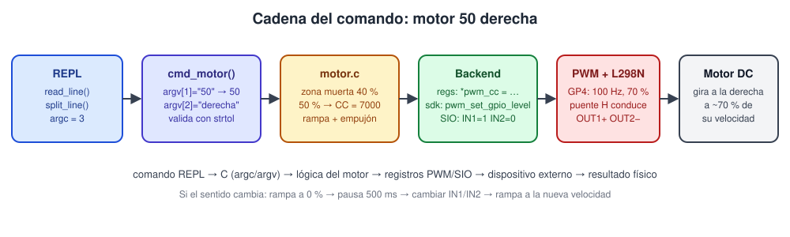

# 6. Comandos del REPL

El proyecto parte del **monitor REPL del curso** (`help`, `on`, `off`, `toggle`, `read`, `sio`, `mask`, `status`) y le agrega tres comandos propios: `motor`, `pwm` y `demo`.



## 6.1 Cómo se integra un comando

Cada comando es una entrada en la tabla `commands[]` de [`main.c`](../firmware/src/main.c):

```c
typedef int (*command_handler_t)(int argc, char **argv);

static const command_t commands[] = {
    ...
    {"motor", "motor <0-100> <derecha|izquierda> | motor stop | motor estado", cmd_motor},
    {"pwm",   "pwm regs|info | pwm modo <regs|sdk> | ...",                     cmd_pwm},
    {"demo",  "Secuencia CHALLENGE 06 ...",                                     cmd_demo},
};
```

1. `read_line()` lee caracteres por USB-CDC hasta Enter.
2. `split_line()` parte la línea con `strtok` en `argv[]` y cuenta `argc`.
3. `execute_command()` busca `argv[0]` en la tabla y llama al *handler*.

Para `motor 50 derecha`:

| | Valor |
|---|---|
| `argc` | 3 |
| `argv[0]` | `"motor"` |
| `argv[1]` | `"50"` (texto, no número) |
| `argv[2]` | `"derecha"` |

## 6.2 Validación de argumentos

```c
static bool parse_uint(const char *txt, uint32_t min, uint32_t max, uint32_t *out) {
    char *fin;
    long v = strtol(txt, &fin, 10);
    if (fin == txt || *fin != '\0' || v < (long)min || v > (long)max) return false;
    *out = (uint32_t)v;
    return true;
}
```

Se usa `strtol` con `endptr` en lugar de `atoi` porque `atoi("50x")` devuelve 50 y `atoi("abc")` devuelve 0 sin avisar.

| Entrada | Resultado |
|---|---|
| `motor` | muestra el uso |
| `motor 50` | muestra el uso (`argc != 3`) |
| `motor 150 derecha` | `Error: velocidad '150' invalida (entero 0-100)` |
| `motor 5o derecha` | `Error: velocidad '5o' invalida` |
| `motor 50 arriba` | `Error: direccion 'arriba' invalida (derecha\|izquierda)` |
| `motor 0 derecha` | detiene el motor (0 % = STOP) |
| `pwm freq 10` | `Error: ... fuera de rango` (DIV > 255.94) |
| `pwm modo foo` | `Error: modo 'foo' invalido (regs\|sdk)` |

## 6.3 Referencia de comandos

### `motor`

| Comando | Acción física |
|---|---|
| `motor <0-100> derecha` | IN1=1, IN2=0; rampa hasta la velocidad |
| `motor <0-100> izquierda` | IN1=0, IN2=1; rampa hasta la velocidad |
| `motor stop` | rampa a 0 %, IN1=IN2=0 |
| `motor estado` | imprime dirección, % lógico, `CC.A`, duty real, frecuencia y backend |

`adelante` / `atras` se aceptan como sinónimos.

Si el motor gira a la derecha y se pide `izquierda`, el firmware **baja a 0 % con rampa**, espera 500 ms y solo entonces invierte (`[SEGURIDAD]` en consola).

### `pwm`

| Comando | Registro afectado | Para qué sirve |
|---|---|---|
| `pwm regs` | lee CSR, DIV, CTR, CC, TOP, EN, GPIO4_CTRL, PADS | ver el periférico en vivo, con dirección y campos decodificados |
| `pwm info` | — | bases, offsets y diferencias de este chip |
| `pwm modo regs` / `sdk` | — | cambia la implementación (punteros ↔ SDK) |
| `pwm freq <hz>` | `DIV` | cambia la frecuencia (100 Hz por defecto) |
| `pwm top <n>` | `TOP`, `DIV` | cambia la resolución manteniendo la frecuencia |
| `pwm fase on\|off` | `CSR.PH_CORRECT`, `DIV` | modo phase-correct (triángulo) |
| `pwm inv on\|off` | `CSR.A_INV` | invierte la salida |

### `demo`

Repite la secuencia del CHALLENGE 06: derecha → rampa a 100 % → 2 s → rampa a 0 → izquierda → rampa a 75 % → 2 s → rampa a 0 → STOP.

## 6.4 Sesión de ejemplo (RP2350)

```text
=====================================
 Monitor REPL RP2350 - PWM Motor DC
 Equipo 2 - L298N: IN1=GP2 IN2=GP3 ENA=GP4
=====================================
Escribe 'help' para comenzar.

RP2350> motor 50 derecha
argv[1] = "50" -> 50 %   argv[2] = "derecha" -> DERECHA (FORWARD)
[DIRECCION] DERECHA (FORWARD)  IN1=1 IN2=0
Acelerando: 0 5 10 15 20 25 30 35 40 45 50 %  (CC.A = 7000 de TOP+1 = 10000)
Motor     : DERECHA (FORWARD) a 50 % logico
ENA GPIO4 : CC.A = 7000 / TOP+1 = 10000  -> duty real 70 %
PWM       : 100 Hz, backend regs (punteros)

RP2350> pwm regs

RP2350  PWM_BASE = 0x400a8000  slice 2 (GPIO4 = canal A)
  offset del slice = 0x14 * 2 = 0x28
  CH2_CSR        0x400a8028 = 0x00000001
  CH2_DIV        0x400a802c = 0x00000960
  CH2_CTR        0x400a8030 = 0x00001a2b
  CH2_CC         0x400a8034 = 0x00001b58
  CH2_TOP        0x400a8038 = 0x0000270f
  EN             0x400a80f0 = 0x00000004
  GPIO4_CTRL     0x40028024 = 0x00000004
  PADS GPIO4     0x40038014 = 0x00000056

  CSR: EN=1 PH_CORRECT=0 A_INV=0 B_INV=0 DIVMODE=0
  DIV: INT=150 FRAC=0/16   TOP=9999   CC.A=7000  CC.B=0
  EN bit 2 = 1   (EN refleja CSR.EN de cada slice)
  clk_sys = 150000000 Hz  ->  f = 100.00 Hz   duty = 70.0 %

RP2350> motor 30 izquierda
argv[1] = "30" -> 30 %   argv[2] = "izquierda" -> IZQUIERDA (REVERSE)
[SEGURIDAD] Bajando a 0 % antes de cambiar de direccion
Desacelerando: 50 45 40 35 30 25 20 15 10 5 0 %  (CC.A = 0 de TOP+1 = 10000)
[DIRECCION] IZQUIERDA (REVERSE)  IN1=0 IN2=1
Acelerando: 0 5 10 15 20 25 30 %  (CC.A = 5800 de TOP+1 = 10000)
...
```

> El valor de `CTR` cambia en cada lectura (es el contador corriendo) y el de `PADS GPIO4` depende del estado de reset de los demás bits del pad. Reemplazar este ejemplo con la captura real como evidencia.
